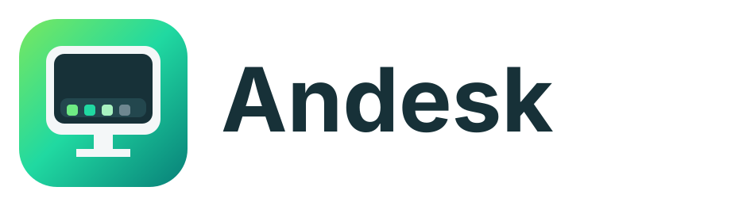

<p align="center"></p>

# Andesk

**A session-owned Android desktop launcher built from Braden Farmer's Taskbar.**

Andesk provides a desktop, taskbar, Start menu, shortcuts, and Android widgets for as long as you have explicitly opened a desktop session. It is **not** intended to keep a permanently running taskbar overlay after the desktop closes.

## Desktop features

- **Desktop-owned lifecycle:** opening an Android app does not end the desktop; returning to Andesk restores the session. Desktop taskbar and Start menu views are hosted directly in the foreground desktop Activity, not by permanent background overlays.
- **Session exit:** Back from the desktop, Alt+F4, and Control Center → Exit Desktop request a full shutdown of taskbar, menus, notification, and overlay services. Removing the desktop from Recents should also end the session.
- **No automatic startup:** after reboot, an app update, process death, or force-stop, the desktop must remain closed until Andesk is explicitly opened again. **An app cannot detect its own force-stop**; Android terminates its process.
- **Desktop controls:** app shortcuts, drag from Start to desktop, files/folders where supported, Android widgets with positioning and resize, and a taskbar with running-app indicators.
- **Appearance:** Classic and Windows 7/10/11-inspired taskbar presets, color/transparency settings, and Compact/Standard/Large sizing.
- **Freeform windows:** request platform freeform windowing on compatible Android devices; Android and device manufacturer restrictions may limit this feature.
- **Control Center:** supported system controls, settings, notification access, and Exit Desktop.

## Install and first launch

Install the latest signed APK from [Andesk's GitHub Releases](https://github.com/coolchan03/Andesk/releases) after it is published. For testing a signed build before release, open a successful [Signed APK Release workflow run](https://github.com/coolchan03/Andesk/actions/workflows/release.yml) and download the **andesk-signed-release** artifact. The separate CI workflow still offers an **andesk-debug-apk** artifact for development, but debug APKs have a different installation ID and signing key and do not update release installations.

The current installation ID is `st.advisory.andesk` (debug builds use `.debug`). This installs separately from earlier builds with the Taskbar package ID; their settings and widgets do not automatically migrate.

Open **Andesk** from the app drawer. The desktop taskbar itself no longer requires overlay or notification permission. Android may request Usage Access for running-app indicators. Display-over-other-apps access is optional for advanced freeform and other external overlays. Widget binding may require a separate Android approval dialog for each provider. Settings screens vary by device manufacturer; return to Andesk after granting access.

## Permissions and special access

Andesk requests only the system permissions and special access used by its functionality. Some are optional and some require a separate Android Settings screen rather than a normal permission dialog.

| Permission or access | Why Andesk uses it |
| --- | --- |
| Display over other apps (`SYSTEM_ALERT_WINDOW`) | Optional external overlays and advanced freeform tools; the desktop's own taskbar no longer requires this permission |
| Notifications (`POST_NOTIFICATIONS`, Android 13+) | Optional notifications for legacy taskbar integrations; no notification permission is needed for the core desktop |
| Foreground service (`FOREGROUND_SERVICE`, `FOREGROUND_SERVICE_SPECIAL_USE`) | Legacy external-overlay compatibility; the foreground desktop now hosts its views directly and stops background overlays on leaving |
| Usage Access (`PACKAGE_USAGE_STATS`) | Identify running/recent apps for the taskbar |
| Notification listener (optional special access) | Display notification counts or related notification indicators |
| Accessibility service (optional special access) | Perform supported global actions when enabled by the user |
| Installed apps (`QUERY_ALL_PACKAGES`) | Populate the Start menu and desktop app picker |
| Shortcuts (`com.android.launcher.permission.INSTALL_SHORTCUT`) | Support legacy shortcut creation on compatible launchers |
| Wallpaper hints (`SET_WALLPAPER_HINTS`) | Adjust wallpaper layout where supported |
| Settings (`WRITE_SETTINGS`, `WRITE_SECURE_SETTINGS`) | Request compatible system-setting changes; secure settings require privileged authorization |
| Network information (`ACCESS_NETWORK_STATE`, `ACCESS_WIFI_STATE`) | Display local network and Wi-Fi state |
| Legacy Wi-Fi/Bluetooth (`CHANGE_WIFI_STATE`, `BLUETOOTH`, `BLUETOOTH_ADMIN`) | Support older platform system controls, subject to Android version limits |
| Delete package request (`REQUEST_DELETE_PACKAGES`) | Open Android's user-confirmed uninstall flow |
| Boot completion (`RECEIVE_BOOT_COMPLETED`) | Reset stale session state and compatibility preferences, **not** automatically start the desktop |
| Widgets (no permission requested) | Andesk hosts widgets through Android's user-approved widget binding screen; `BIND_APPWIDGET` is a system-only permission and is deliberately not requested |
| Andesk signature-protected actions | Restrict internal desktop start/stop and freeform-control broadcasts |

Andesk **does not request the `INTERNET` permission**. Optional Shizuku integration, if installed and authorized by you, permits advanced system operations on compatible devices. System permissions do not grant unlimited access.

### Enable notification and accessibility access

For **notification access**, open **Android Settings → Apps → Special app access → Device & app notifications / Notification access**, then select Andesk if listed. This is separate from the ordinary **Allow notifications** prompt on Android 13+. You can leave notification-listener access disabled if you do not need its optional indicators.

For **accessibility access**, open **Android Settings → Accessibility → Installed apps / Downloaded apps → Andesk**, then enable its service only if you want the related system actions. Android may display a warning explaining the capabilities of an accessibility service. You can turn it off later in the same menu.

For **overlay permission**, look in **Android Settings → Apps → Special app access → Display over other apps**. For **Usage Access**, open **Special app access → Usage access**. Device manufacturers may use different labels.

## Backups and privacy

Android automatic app-data backup is disabled to avoid restoring incompatible widget IDs and display settings on another device. You can still export and restore backups manually using Andesk's settings.

Read the [Andesk privacy policy](Privacy-Policy.md).

## Device verification checklist

Before reporting an APK as stable, check on your device:

1. Launch Andesk, complete permissions, and confirm the desktop/taskbar appear.
2. Open another Android app and return to Andesk without losing the desktop layout.
3. Add, drag, move, and resize shortcuts/widgets; check persistence after reopening the desktop.
4. Change taskbar theme/size, collapse and expand, and check full-width bottom-edge alignment and gesture navigation.
5. Launch a freeform-capable app and confirm the title bar is reachable, especially near the upper edge and in landscape.
6. Exit using Back, Alt+F4, Control Center, and Recents swipe-away separately. The taskbar, overlays, and notification should disappear.
7. Reboot and force-stop the app separately; neither should launch a fresh desktop without user action.

Device-dependent restrictions may require manual follow-up. In particular, Android 15 edge-to-edge behavior and background activity launch restrictions cannot be confirmed by unit tests alone.

## Building and contributing

CI uses JDK 21 and the Android toolchain on a temporary GitHub Actions runner, so installing an Android SDK on your personal computer is not required to review, contribute, or download a CI-built APK.

The CI workflow checks formatting, builds a debug APK, runs unit tests, and checks Android lint. The separate signed-release workflow repeats quality checks, builds a release APK using the private GitHub Actions keystore secrets, verifies the APK signature, and uploads an artifact. Pushing a version tag such as `v0.1.0` also publishes a GitHub release, provided the tag matches `VERSION_NAME` in `dependencies.gradle`. Keep the release keystore and its passwords backed up privately; future updates must be signed using the same key.

```text
./gradlew spotlessCheck
./gradlew assembleFreeDebug
./gradlew testFreeDebug
./gradlew lintFreeDebug
./gradlew assembleFreeRelease  # only in the signed-release workflow
```

See [CONTRIBUTING.md](CONTRIBUTING.md) for development conventions and pull-request requirements.

## Origin and license

Andesk is derived from [Taskbar by Braden Farmer](https://github.com/farmerbb/Taskbar) and retains upstream attribution and Apache License 2.0 terms; see [LICENSE](LICENSE). It is not affiliated with Samsung, Google, or the Android project. References to DeX or Windows describe appearance and workflows, not endorsement.
